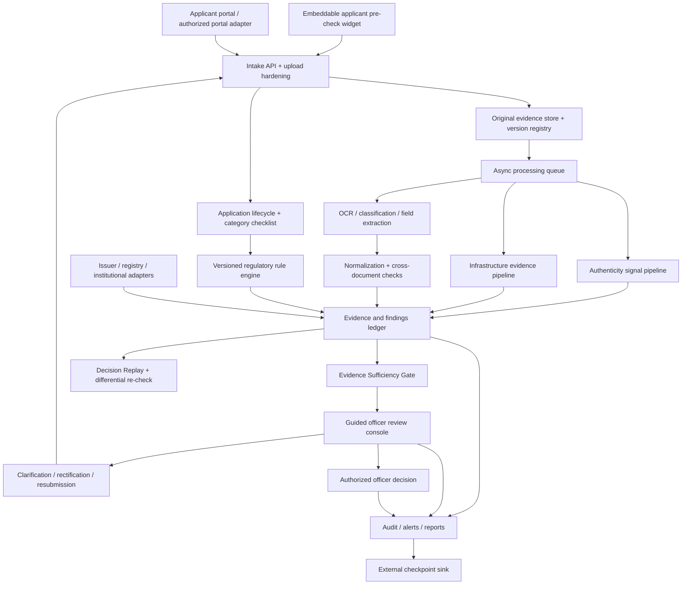

# Pramāṇa — Final SIH Solution
## AICTE Application Validation, Document Authentication & Regulatory Compliance Verification

**Problem Statement:** SIH 26261 · AICTE · Software · Smart Automation  
**Document purpose:** Final concept proposal and PPT source of truth for the SIH internal-selection submission; includes architecture, complete PS coverage, rollout plan, and technical risk audit.  
**Source files compared:** `solution.md` (the frozen MVP document corresponding to the user's “solution-1”) and `solution-2.md`.  
**Revision note (v2):** This version folds in a second design-review pass: configurable readiness thresholds, finding classes with rectification notices, formula-type rules, Decision Replay and differential re-check, supersede-only corrections, database-level audit protection with external checkpoints, PDF structure inspection, upload hardening, a deterministic geotag rule, officer-assisted floor-plan measurement, sampled video review, a QR lookup adapter (conditional), identity-overlap checks without biometrics, baseline/enhanced operating modes, a two-portal demo with an embeddable applicant pre-check, requirement-to-test traceability, and an English + Hindi interface commitment. Cross-application analytics is now framed consistently as *designed now, built in Phase 4*.  
**Presentation-stage framing:** This is a proposed solution architecture for the PPT round. The team is not claiming that the platform has already been implemented. The national-finale build phase is where the proposed workflows, integrations, and models will be implemented and tested. The coverage matrix includes the A–F breakdown in `solution-2.md` and the detailed functional requirements reproduced in an SIH 26261 problem-statement archive, including institutional records, issuer verification, infrastructure evidence, alerts, audit, and evaluation. The official SIH listing remains the final wording authority; this document consolidates those requirements into a presentation-ready design.

---

## 1. Executive Summary

**Pramāṇa** (प्रमाण — evidence/proof) is a proposed AICTE application-validation and regulatory-compliance platform that helps officers review institution applications through one evidence-linked workflow. It combines deterministic rules, document intelligence, issuer verification adapters, infrastructure evidence review, cross-application pattern detection, and a secure officer dashboard.

The platform is designed to address the full problem space captured in the source drafts:

1. **Validate applications** for completeness, required fields, format, and consistency within and across documents.
2. **Authenticate documents** by checking exact/near duplicates, signature validity where supported, suspicious edits, issuer records, and inconsistencies.
3. **Verify regulatory compliance** against versioned AICTE Approval Process Handbook rules, with clause-linked explanations.
4. **Review infrastructure evidence** such as geo-tagged photos, floor plans, videos, land records, and declarations; use computer vision as an advisory signal and route uncertain or high-risk cases to officers.
5. **Centralize officer workflow** through a role-based dashboard, evidence drill-down, rectification/escalation actions, and a tamper-evident audit trail.
6. **Detect cross-application patterns** across institutions and years, including repeated documents, related entities, and suspicious reuse patterns.
7. **Integrate external sources** through adapters, with live verification enabled only where AICTE authorization and source APIs permit it.
8. **Support pan-India use** through scalable processing design, responsive access, and an English + Hindi interface (further languages are extension work).
9. **Move checking to the earliest stage** with an embeddable applicant pre-check that gives institutions instant deficiency feedback before they submit, so fewer defective applications reach officers.

### Core differentiator

Pramāṇa does not merely return a pass/fail label. Each finding is designed to show **what was checked, which evidence triggered it, which rule or source was used, how confident the system is, and what the officer should review next**. The system assists the officer; it does not replace AICTE's statutory decision-making authority.

Beyond that, five properties are meant to be demonstrable on screen rather than merely asserted:

1. **Three visibly separate layers** — check result, evidence readiness, officer decision.
2. **A coverage statement on every case** — “9 of 11 mandatory checks ran; these two did not, and here is why.” Absence of evidence is made visible instead of being silently treated as a pass.
3. **Decision Replay** — any closed case can be re-executed under the rule version, software version and reference date that applied at the time, and compared with what was recorded.
4. **Governed rule packs** — rules stay inactive until source-verified and reviewed; an ambiguous clause yields `MANUAL_REVIEW_REQUIRED`, never a guess.
5. **Applicant pre-check** — the same validation core can run inside an embeddable widget, catching deficiencies before submission.

### Presentation strategy

The PPT should present Pramāṇa as a coherent, end-to-end **proposed system**, not as a list of disconnected AI features. Describe the target workflow, architecture, modules, and planned national-finale build. Use “designed to”, “will verify”, and “proposed integration” for capabilities that have not yet been implemented; do not describe mock adapters or future models as already connected or validated.

---

## 2. Comparison of the Two Solution Drafts

| Area | `solution.md` / Solution 1 | `solution-2.md` / Solution 2 | Final decision and rationale |
|---|---|---|---|
| Product scope | Frozen, narrow EoA workflow with three document types | Broad platform covering many application types and A–F modules | Adopt Solution 1's bounded EoA MVP; retain Solution 2's broader areas as roadmap/traceability requirements. |
| Delivery honesty | Explicit P0/P1/P2 split and explicit non-claims | Coverage table labels several features “fully built & demoed” without evidence in the file | Frame the deck as a proposed architecture and distinguish planned capabilities from any demonstrable prototype. Do not use “already built/live-integrated” wording unless the team has proof. |
| Core architecture | FastAPI, PostgreSQL, Tesseract, pyHanko, React; mock portal and adapters | Similar stack, but adds many technologies including YOLO, RAG, Neo4j, XGBoost, Kubernetes, i18n | Keep the smaller stack. Do not introduce extra services unless a requirement and a demo justify them. |
| Application categories | EoA only | New institution, EoA, intake increase and more | EoA for MVP. Other categories require separately configured checklists and rule validation. |
| Document types | Three named document types | Many categories: land, finance, faculty, infrastructure, approvals, certificates, etc. | Three document types for the demonstrable path; make the checklist extensible, but do not claim broad coverage. |
| Validation | Deterministic completeness, expiry, and cross-document checks | Same, with broader ML-based detection | Implement deterministic checks first because they are easier to test and explain. |
| Authentication | SHA-256 exact duplicate check; optional near-duplicate; test PDF signature validation; simulated issuer adapter | Adds ELA/CNN tamper localization, metadata analysis, QR checks, multiple issuer integrations | Keep SHA-256 and one tested signature path in MVP. Near-duplicate is P1. Add deterministic PDF structure inspection (revision history, producer tags, hidden text, font mix on numeric fields) before any image-based tamper model. Visual tamper detection and live issuer integrations are roadmap until benchmarked/authorized. |
| Regulatory compliance | Versioned, traceable rules; only a small, cited EoA ruleset | Full handbook rules engine plus RAG compliance assistant | Implement a small set of verified clauses. RAG is optional and must cite official sources; it must not be treated as the compliance decision engine. |
| Infrastructure verification | Safer and narrower; does not fully cover the physical-evidence requirement | Includes geo-tagged photos/videos, floor plans, image reuse checks, CV indicators, and land-record cross-checks | Include infrastructure evidence as a first-class module in the proposed solution and PPT. Explain that visual AI flags are advisory and require officer/inspection review. |
| Cross-application fraud | Not part of P0; no graph database needed for the evidence model | Fraud graph, entity correlations, risk score | Designed now, built in Phase 4. Begin with relational queries and seeded synthetic multi-application examples; no Neo4j/XGBoost dependency is needed for the first build. Include identity-overlap checks on submitted record fields only (no biometrics). |
| Evidence model | Relational PostgreSQL model, findings linked to rule/document/source | “Evidence ledger” and hash-chained audit log; also discusses graph-based analytics | Use PostgreSQL relational evidence tables. Hash-chaining can make changes detectable but does not by itself make the whole system immutable or prove the truth of records. Pair it with database-level write protection and an externally held checkpoint of the chain head. |
| LLM role | Optional bounded explainer over structured findings; no raw document access; no decisions | RAG assistant, risk scoring, and other AI assistance | Use no LLM in the critical validation path. Add an optional summarizer only after core checks work; keep regulatory Q&A separate and source-cited. |
| Integration | Mock AICTE portal and labelled simulated issuer adapters | Lists DigiLocker, NAAC/NBA, UDISE+/AISHE, PAN/GST, state portals, Aadhaar | Common adapter contract is retained. All external systems are future/conditional unless access, permission, and technical API availability are proven. |
| Security | RBAC, labelled synthetic sources, append-only audit log, no autonomous decisions | Adds encryption, JWT, retention, centralized dashboard, hash-chained ledger | Adopt security requirements as design goals; do not claim production security without tests, threat modelling, deployment evidence, and operational controls. |
| Demo | Twelve-step, specific synthetic EoA scenario | Broader dashboard, infrastructure, graph and RAG demo | Use Solution 1's concrete demo path. Present broader modules as roadmap, not live functionality. |
| Evaluation | Explicitly says measure results; do not invent accuracy or time savings | Suggests impact metrics and includes unverified built-status claims | Keep the measurement discipline. Publish only measured results with dataset size and test method. |

### Consolidation conclusion

**Solution 1 remains the stronger implementation baseline; Solution 2 remains the broader coverage checklist.** The repository review adds several architectural patterns worth incorporating without blindly copying any repository's claims: an evidence-sufficiency gate, governed rule-pack activation, guided one-finding-at-a-time review, explicit lifecycle transitions, provenance-preserving evidence handling, robust adapter failure states, and a first-class infrastructure evidence workflow. These are incorporated below as design decisions. A second review pass added further patterns: configurable readiness thresholds with weakest-signal reporting, separate finding classes, formula-type rules, Decision Replay, differential re-checks, supersede-only corrections, database-level audit protection with external checkpoints, hardened uploads, PDF structure inspection, and an applicant-side pre-check. The first-pass table in 2.1 is retained; Section 2.2 lists what was deliberately **not** adopted. Repository READMEs and self-reported metrics are reference material, not proof that the same results will be achieved by Pramāṇa.

### 2.1 Repository research: patterns adopted into Pramāṇa

The repositories reviewed were specific to SIH 26261 and adjacent implementations of the same AICTE validation problem. The review compared documented architecture and selected files/READMEs; it was **not** a full clone, code audit, reproducible benchmark, or independent validation of every repository's implementation.

| Repository/reference | Useful pattern observed in the reviewed material | Pramāṇa design decision | What we will not assume |
|---|---|---|---|
| [Adi-ctive/pramaan](https://github.com/Adi-ctive/pramaan) | Portal-independent validation core; adapters; versioned rule packs; guided reviewer flow; completion checks; documented experiments and limitations for visual analysis | Separate the validation engine from portal integrations; add rule lifecycle/governance; use a guided review queue; retain explicit test and limitation reporting | Do not copy its reported floor-plan/video/handwriting performance as Pramāṇa performance. The reviewed progress notes report weak results for some visual tasks, which reinforces the need for scoped claims and measured evaluation. |
| [atharva23x/verigate](https://github.com/atharva23x/verigate) | Evidence-gating concept that considers OCR confidence, issuer checks, tamper signals, duplicates, and cross-record consistency | Add an **Evidence Sufficiency Gate** that decides whether a case has enough resolved evidence to proceed to a defensible officer decision | Do not turn a composite score into a legal verdict. Keep individual signals visible and the gate separate from compliance and officer decisions. |
| [aquasimp/SIH26261](https://github.com/aquasimp/SIH26261) and [ANUJ-YADAV22/SIH26261](https://github.com/ANUJ-YADAV22/SIH26261) | Broad regulatory review workstation; infrastructure analysis; distinction between fixable deficiency and suspected fraud | Make infrastructure evidence a complete module; distinguish rectifiable deficiency, unresolved evidence, and suspected fraud/escalation | Treat closely similar descriptions as related reference material, not automatically as independent innovation. Do not adopt named statutory timelines/forms without official verification. |
| [omkardiggi/sih26261-scandoc](https://github.com/omkardiggi/sih26261-scandoc) | Original-file preservation, derivative outputs, OCR provenance, explicit processing states, retry/idempotency concepts, access control, audit history | Preserve originals; store OCR/extraction as derivatives; capture page/region provenance where available; define processing states, retry policy, and backend authorization | A hash chain alone does not make the database immutable or make submitted claims true. |
| [sethupathy03/sih26261-satyapramaan](https://github.com/sethupathy03/sih26261-satyapramaan) | Multiple verification signals combined in a review workflow | Keep hash, signature, issuer response, OCR quality, metadata, consistency, and regulatory compliance as distinct signals in the evidence record | Do not collapse unrelated signals into one opaque “trust score”; SHA-256 is not proof of authenticity. |
| [sarthakrajwar06/SIH26261](https://github.com/sarthakrajwar06/SIH26261) | Application lifecycle, reviewer correction, implementation/testing documentation | Define explicit state transitions, reviewer corrections, and acceptance tests for every core module | Documentation alone does not prove real-world performance. |
| [navyaanubhutii/AICTE-VERITAS](https://github.com/navyaanubhutii/AICTE-VERITAS) | Versioned uploads, clarification/resubmission, and audit timeline | Model each resubmission as a new document version and retain the prior version and its findings | Do not overwrite evidence or silently rewrite old findings after a resubmission. |
| [sathvik210508/SmartValidate reference](https://github.com/sathvik210508/AI-Powered-Application-Validation-Document-Authentication-Regulatory-Compliance-Platform) and [rajaryan1111/aicte-compliance-ai](https://github.com/rajaryan1111/aicte-compliance-ai) | Deterministic checks, mock source adapters, careful rule activation, and explicit OCR limitations | Keep deterministic checks central; label simulated sources; block unreviewed rules from production activation | A mock source result is not external verification. |
| [Mukhesh-san/eduverify-ai](https://github.com/Mukhesh-san/eduverify-ai) and [SnehaGurav-create/Pragyan_AICTE-Document-Validation](https://github.com/SnehaGurav-create/Pragyan_AICTE-Document-Validation) | Helpful scope/UI references; documented gaps in some proposed implementations | Use as secondary references for workflow coverage and screen planning | Do not infer that OCR, persistence, or trusted-source verification works merely because it appears in a README. |

**Design synthesis:** every regulatory finding must be traceable to evidence and a versioned rule; every unresolved uncertainty must remain visible; and the application must not progress to a final decision merely because an aggregate score looks favourable. Infrastructure review, source verification, and cross-application correlation remain distinct workflows whose outputs are combined for officer triage—not merged into a single opaque AI verdict.

### 2.2 Ideas deliberately not adopted

| Idea seen in reviewed material | Why Pramāṇa leaves it out | What Pramāṇa does instead |
|---|---|---|
| Automatic approval/rejection driven by a numeric trust level | Conflicts with the human-decision safeguard in the problem statement | The readiness gate only routes work; only an authorized officer records a decision |
| One blended authenticity/trust score with a veto rule | Opaque aggregate that hides which signal drove the outcome | Independent signals, with the *limiting* (weakest) signal reported |
| Face matching or biometric checks on staff; linkage to restricted employment or identity databases | Privacy and legal exposure; assumes access we have not been granted | Identity-overlap check using normalized fields from submitted records only |
| Self-reported accuracy figures from other projects | Not reproducible; quoting them borrows credibility we cannot defend | Measure-first policy in Section 10 |
| Named live integrations presented as working | Access and authorization are unproven | Labelled live / sandbox / simulated adapters |
| Third-party hosted vision services for real institutional documents | Sends sensitive documents off-premises | Local processing; optional local models only |
| Hard-coded statutory day-counts, area tolerances, or gate numbers | Unverified against the handbook | Configurable, versioned parameters with a cited source |

---

## 3. Requirements and Design Principles

### 3.1 Deterministic-first, AI-assisted

- Required-field checks, date checks, comparisons, hashing, and rule evaluation should be deterministic and unit-tested.
- OCR and AI extraction are fallible; retain confidence/provenance and permit officer correction.
- Optional LLM functionality may summarize already-created findings. It must not create an unsupported finding, assert a document is authentic, interpret missing evidence as compliance, or decide approval/rejection.
- Regulatory guidance generated through retrieval must show the actual handbook/circular reference and relevant passage. A RAG answer is guidance, not an authoritative ruling.

### 3.2 Evidence-linked findings and original preservation

Every finding should include at least:

- `finding_id`, `application_id`, `check_id` / `rule_id`
- rule/check version, source clause, and effective date where applicable
- document ID(s), extracted field(s), source page/region or bounding box where available
- raw and normalized values compared, plus the normalization/comparison method
- status, severity, explanation, timestamp, and source provenance
- processing/model/software version where relevant
- reviewer correction, action, rationale, actor, and timestamp when actioned

The originally submitted file is preserved as a read-only evidence object. OCR text, thumbnails, extracted fields, redacted views, and CV annotations are derivative artifacts linked to the original; they must never silently replace it. A re-upload creates a new document version with its own digest and provenance. Findings from the prior version remain in history and are superseded only through an explicit re-run or review event.

### 3.3 Verification statuses

Do not collapse unknown into pass or fail. Use a status taxonomy such as:

- `PASS` — the specific deterministic check passed
- `DEFICIENCY_FOUND` — a defined requirement was not met
- `MISMATCH_FOUND` — two sources disagree under a documented comparison rule
- `POSSIBLE_DUPLICATE` — duplicate/similarity indicator requiring review
- `SIGNATURE_VALID` — cryptographic signature check passed under the configured trust policy
- `SIGNATURE_INVALID_OR_BROKEN` — signature validation failed; report exact reason
- `SOURCE_UNAVAILABLE` — external verification could not be completed
- `VERIFICATION_PENDING` — awaiting source, reviewer, or additional evidence
- `LOW_CONFIDENCE_EXTRACTION` — extracted field requires manual confirmation
- `MANUAL_REVIEW_REQUIRED` — system cannot reach a defensible automated result
- `CHECK_NOT_RUN` — a mandatory check did not execute (shown in the case coverage statement; never treated as a pass)
- `GEOTAG_ABSENT` — a photo carries no usable location metadata; more evidence is needed, which is not the same as a failure
- `STRUCTURE_INDICATOR` — a PDF-structure observation (for example, post-signing revision or mixed fonts on a number) that warrants review; it is an indicator, never a forgery verdict

A status is scoped to the check. For example, `SIGNATURE_VALID` does **not** mean every claim in the document is true, and a missing digital signature does not prove forgery.

### 3.4 Three separate outcomes: check result, evidence sufficiency, officer decision

Pramāṇa must never compress these three layers into one score or one status:

1. **Check result:** what a specific rule, comparison, source adapter, or analysis returned (`PASS`, `MISMATCH_FOUND`, `SOURCE_UNAVAILABLE`, etc.).
2. **Evidence sufficiency:** whether all mandatory checks have run and whether any unresolved critical uncertainty prevents the case from being ready for a defensible decision.
3. **Officer decision:** the authorized officer's actual regulatory disposition, with rationale and audit record.

The Evidence Sufficiency Gate is a workflow control, not an approval engine. It evaluates a configurable checklist of mandatory checks, required source responses, critical-field extraction quality, unresolved conflicts, and required human reviews. If a mandatory check is missing, a source is unavailable where verification is required, a critical field is low-confidence, or a critical discrepancy remains unresolved, the case is routed to `EVIDENCE_INCOMPLETE` or `MANUAL_REVIEW_REQUIRED`. A high average confidence or low anomaly score must never cancel a critical unresolved issue. Officers may still use authorized judgement under the governing process, but the system must make the unresolved issue explicit and record the override rationale.

**Readiness profile (configurable starting points, to be calibrated).** The gate reads a *versioned readiness profile* instead of hard-wired constants. The profile version used is stored with every assessment.

| Readiness signal | Default condition | If not met |
|---|---|---|
| Mandatory checks executed | Every check on the category checklist has a recorded run | `EVIDENCE_INCOMPLETE` |
| Critical-field extraction quality | Each critical field is above its per-field confidence floor, or officer-confirmed | `LOW_CONFIDENCE_EXTRACTION` → `MANUAL_REVIEW_REQUIRED` |
| Unresolved critical findings | None open | Blocked until resolved or escalated |
| Issuer/registry-backed documents | Each has a terminal response (verified, mismatch, expired) or a recorded officer decision to proceed | `VERIFICATION_PENDING` |
| Duplicate / similarity candidates | All reviewed by an officer | Blocked until reviewed |
| Cross-document consistency | No unreviewed conflict on identity-defining fields | Blocked until reviewed |

**Limiting-signal reporting.** The gate output names the *weakest* signal and the specific blocker. It never reports a mean or composite value, so a strong signal cannot mask a weak critical one. Numeric floors ship as clearly labelled placeholders and are calibrated against the labelled evaluation set before any claim is made about them.

### 3.5 Rule-pack governance

Each rule has a lifecycle: `DRAFT` → `SOURCE_VERIFIED` → `REVIEWED` → `ACTIVE` → `RETIRED`. Activation requires a source reference, applicable category, effective date, rule owner/reviewer, test cases, and a version identifier. Rule changes create new versions; past check runs retain the version actually used. If the applicable clause is ambiguous, superseded, or not yet reviewed, the rule remains inactive and the result is `MANUAL_REVIEW_REQUIRED` rather than a guessed compliance decision.

### 3.6 Finding classes and rectification notices

Alongside its status, every finding carries one **class**, so that a missing document and a suspected splice never look alike on screen:

- `RECTIFIABLE_GAP` — something the applicant can fix (missing document, expired certificate, blank mandatory field). It feeds a drafted notice with a response deadline.
- `INTEGRITY_CONCERN` — signs that the evidence itself may be unreliable (conflicting identifiers, structure indicators, reused imagery, failed signature). No applicant notice is generated automatically; the case routes to senior review, and wording avoids the word “forged”.
- `UNVERIFIABLE_ITEM` — the system could not confirm something because a source was unavailable or evidence was absent. It is neither pass nor fail, and it stays listed in the coverage statement.

**Notice drafting.** From the open `RECTIFIABLE_GAP` findings, the system drafts a notice in English and Hindi from a template, with clause references and a countdown. The response period is a configuration value; a statutory figure is entered only after it has been verified against the official source, otherwise the officer supplies it. The officer reviews and approves before anything is sent, and the notice is stored as a versioned record.

### 3.7 Operating modes and graceful fallback

- **BASELINE mode (CPU only):** deterministic checks, Tesseract OCR, hashing, signature validation, PDF structure inspection, rule engine, geotag and area calculations. Always available; sufficient for the complete demonstration.
- **ENHANCED mode (optional):** additional models (for example embeddings or a vision model) plugged in behind the same adapter interface, enabled only after evaluation on a labelled set.
- Any optional component, including the LLM explainer, falls back to the baseline path when unavailable. The fallback is recorded in the check run, and “component unavailable” is never shown as a pass.

### 3.8 Rule types

The rule engine supports four types, each carrying a clause reference, version and effective date:

1. **Presence rules** — a required document or field exists.
2. **Threshold rules** — a value meets a configured limit.
3. **Formula rules** — a requirement is computed from named inputs (for example, required area derived from approved intake and a per-unit norm). The result view shows inputs, formula, output, clause and version.
4. **Cross-record rules** — a value agrees across documents or with an institutional record under a stated comparison method.

Constants inside formula rules are rule parameters with their own source citation. No constant is activated until it is checked against the applicable handbook and reviewed by a second person; unverified constants leave the rule `DRAFT`.

### 3.9 Decision Replay and differential re-check

- **Decision Replay.** Each check run stores the rule version, software/model version, reference date and input digests. A closed case can therefore be re-executed in an isolated sandbox under those exact versions and compared with the recorded findings. Uses: audit, appeals, and impact analysis when a rule changes. Replay never alters the original record; it writes a separate replay-run record. Differences are shown for investigation, not as an automatic error verdict, and non-deterministic components are flagged as such.
- **Differential re-check.** Each check declares which inputs it depends on. On resubmission, only checks whose inputs changed are re-run (plus the readiness gate), and the officer sees a version-to-version diff: resolved, new, unchanged, and changed findings.

### 3.10 Supersede, never edit

Officer corrections, decisions and notices are new records that point to what they supersede; earlier records are not updated in place. Every state-changing endpoint requires an idempotency key, so a double-click or network retry produces exactly one record. Database permissions and triggers deny UPDATE/DELETE on audit and decision tables (see Section 6).

---

## 4. Final Proposed Scope

This document is the **solution blueprint for the PPT round**. The goal now is to communicate complete problem-statement coverage and a credible build plan. The team expects to implement and validate the system during the national-finale preparation/build window if selected.

### 4.1 Core application workflow

- Application intake, category selection, and a versioned checklist tailored to the application type.
- Original-file preservation, document versioning, safe file intake, OCR/classification, and field extraction with confidence and page/region provenance where supported.
- Completeness, format, expiry, and cross-document/institutional-record consistency checks.
- Distinct authenticity signals: exact/near duplicates, supported PDF signature validation, PDF structure inspection, metadata anomalies, issuer/registry response (including official-QR lookup where permitted), and visual anomaly indicators.
- Versioned regulatory rule engine linked to the applicable official source clause and effective date, with rule review/activation governance.
- Full infrastructure evidence workflow for photos, videos, floor plans, certificates, metadata/geotags, prior-year/image-reuse comparison, relevant land/ownership records, and officer/inspection review.
- Evidence Sufficiency Gate to detect missing mandatory checks, unresolved critical findings, weak extraction on critical fields, and incomplete external verification.
- Centralized case queue with guided finding review, evidence drill-down, rectification/clarification/resubmission, escalation, role-based permissions, and audit trail.
- Cross-application/longitudinal correlation for repeated documents and suspicious institution/entity patterns, with explainable links and human review.
- Portal-independent validation core with adapters for authorized portal, issuer, registry, and notification integrations.
- Scalable asynchronous processing, explicit retries/timeouts/idempotency, and a responsive English + Hindi interface.
- Finding classes (rectifiable gap / integrity concern / unverifiable item) with officer-approved, bilingual rectification notices.
- Configurable readiness profile for the Evidence Sufficiency Gate, with weakest-signal reporting and a per-case coverage statement.
- Formula-type rules alongside presence/threshold rules; Decision Replay and differential re-check on resubmission.
- Embeddable applicant pre-check widget, demonstrated against two different mock host portals on the same validation core.
- Side-by-side comparison of submitted values against the institutional record; per-case verification report and injection-safe CSV export; read-only auditor role.

### 4.2 Proposed implementation sequence after selection

**Phase 1 — Core workflow and governance:** application intake, original-file/version handling, OCR and field provenance, deterministic validation, evidence-linked findings, application lifecycle, officer queue, audit events, the initial Evidence Sufficiency Gate with a configurable readiness profile, upload hardening, finding classes, supersede-only corrections with idempotency keys, database-level audit write protection, and the English/Hindi interface scaffold.

**Phase 2 — Authentication and rule governance:** exact duplicate detection, supported PDF signature validation, metadata/identifier consistency checks, versioned rule packs and activation workflow, issuer-adapter contract, source-unavailable handling, PDF structure inspection, formula-type rules, the conditional official-QR lookup adapter, and Decision Replay.

**Phase 3 — Infrastructure evidence workflow:** photo/video/floor-plan intake, metadata/geotag review, prior-year/image-reuse comparison, baseline visual indicators, land/ownership record adapter design, and officer/inspection review. Deterministic geotag-distance rule, officer-assisted floor-plan measurement, and sampled-frame video review are built before any advanced visual model; such models are selected only after a representative evaluation set exists.

**Phase 4 — Cross-application and operational hardening:** longitudinal correlation and explainable relationship views, alerts, retry/idempotency handling, role/tenant isolation, audit integrity checks, performance/load testing, language/accessibility improvements, the embeddable applicant pre-check with a second mock portal, differential re-check, external audit-checkpoint publication, requirement-to-test traceability reporting, and a hosted prototype link with a short demo video.

The phases are sequencing priorities, not a claim that only Phase 1 is part of the proposed solution. The PPT must show every PS requirement; the implementation sequence explains how the team will build it within the available time.

### 4.3 Explicit technical boundaries

- An anomaly score is a **review signal**, not proof of forgery.
- SHA-256 detects exact byte-level duplicates; it does not establish that a document is genuine.
- Digital-signature validation must report the configured trust/validation result; a valid signature does not prove that every statement in the document is true.
- Geo-tags and metadata can be missing or manipulated; they are supporting evidence, not conclusive location proof.
- Computer vision can flag visible patterns or possible mismatches, but cannot independently certify legal land ownership or overall infrastructure compliance.
- External verification is live only where an authorized, documented integration is available. The adapter architecture supports mock/sandbox responses during development.
- PDF structure observations (revision count, producer tags, hidden text, font mix) are indicators; legitimate re-saving, merging or scanning workflows can trigger them.
- Floor-plan area is computed from an officer-calibrated scale and traced outline; its accuracy depends on drawing quality and the scale reference the officer selects.
- The official-QR lookup is built only if the issuing body's status pages are confirmed to be publicly reachable and permitted for this use.
- Identity-overlap checks use submitted record fields; they do not use biometrics or restricted databases.
- Configurable thresholds and rule parameters are starting points until calibrated and, for statutory values, verified against the handbook.
- AICTE officers retain final approval/rejection authority.

---

## 5. Proposed Architecture

Pramāṇa is designed as a **portal-independent validation core** surrounded by intake, evidence processing, verification adapters, and an officer decision workflow. The system separates raw evidence, automated check results, evidence sufficiency, and the final officer decision.

### Architecture layers and responsibilities

| Layer | Responsibility | Design rules |
|---|---|---|
| Applicant/portal integration | Accept submissions from the current portal or a future authorized integration | Use adapters and a stable internal contract; do not couple regulatory logic to portal-specific payloads. |
| Intake and lifecycle | Validate file type/size, assign IDs, create application state, and record each submission/version | Treat uploads as untrusted and apply the upload hardening checklist; make state transitions explicit, idempotent and auditable. |
| Original evidence store | Preserve original bytes and store derivative outputs separately | Compute a digest at intake; access-control originals; never overwrite a prior version. |
| Async processing | Schedule OCR, visual analysis, source calls, and re-runs | Use idempotency keys, timeouts, bounded retries, and explicit failed/needs-review states. |
| Document intelligence | Classify documents, extract fields, preserve raw values and page/region provenance | Low-confidence critical fields cannot silently satisfy mandatory checks. |
| Authenticity signals | Exact hash, similarity, supported signature validation, metadata and issuer signals | Store each signal independently with method, scope, source, timestamp, and limitations. |
| Infrastructure evidence | Analyze submitted photos, videos, floor plans, metadata, prior submissions, and relevant records | Visual indicators are advisory; uncertain or high-impact issues go to officer/inspection review. |
| Cross-record correlation | Compare normalized institution/document/entity fields across current and historical records | Preserve raw values; explain match features; fuzzy matches trigger review rather than silently merging entities. |
| Regulatory rule engine | Evaluate active, versioned rules against structured facts | Only reviewed rules linked to authoritative sources can be activated; past runs retain their rule version. |
| Evidence Sufficiency Gate | Decide whether required checks/evidence are complete enough for the next workflow state | It does not decide compliance or approve/reject; critical unresolved issues cannot be averaged away. |
| Guided officer console | Present one finding at a time with evidence, rule, source, context, and next action | Support correction, request information, mark reviewed, resolve, or escalate with rationale. |
| Audit, alerts, and reporting | Record machine/human events and notify about missing, expired, pending, or escalated items | Maintain a traceable timeline; label source responses as live, sandbox, or simulated. |
| Replay and re-check | Re-execute closed cases under stored versions; re-run only affected checks on resubmission | Write results to separate replay/diff records; never modify the original case record. |
| Operating modes | Keep a CPU-only baseline always available; plug optional models behind the same interface | Record any fallback in the check run; an unavailable component is never a pass. |

### Application lifecycle

Use an explicit state machine rather than a single loosely defined `status` field. A suggested lifecycle is:

`DRAFT` → `SUBMITTED` → `PROCESSING` → `EVIDENCE_REVIEW` → `READY_FOR_OFFICER_REVIEW` → `UNDER_OFFICER_REVIEW` → (`NEEDS_CLARIFICATION` → `RESUBMITTED` → `PROCESSING`) or (`ESCALATED`) → `DECISION_RECORDED` → `CLOSED`.

Additional terminal/exception states may include `WITHDRAWN`, `PROCESSING_FAILED`, and `EVIDENCE_INCOMPLETE`. Transitions must be validated on the backend, authorized by role, and recorded in the audit trail. A resubmission creates a new version; it does not erase the previous evidence or history.

### Suggested stack

- **Backend/API:** Python + FastAPI, with a stable internal job/check contract.
- **Database:** PostgreSQL for applications, versions, rules, findings, verification results, and audit metadata.
- **Original/derived file storage:** access-controlled object or filesystem storage; the storage provider is a deployment decision.
- **Async jobs:** a background worker and queue appropriate to the chosen deployment; avoid adding distributed infrastructure until workload needs are defined.
- **OCR:** Tesseract or an alternative selected after testing on representative documents and languages.
- **PDF/signature:** `pypdf` for parsing and `pyHanko` for supported PDF signature validation under an explicit trust configuration.
- **Hashing:** Python `hashlib` SHA-256 for exact-byte identity/integrity comparisons.
- **Similarity (later phase):** perceptual image hashes and OCR-text similarity, evaluated against legitimate template variations and altered samples.
- **Frontend:** React for the officer console and applicant/rectification screens; a dictionary-based i18n layer for English and Hindi; the applicant pre-check packaged as an embeddable widget with style isolation so it cannot clash with a host portal.
- **PDF structure and media inspection:** `pypdf` and/or PyMuPDF for revision, producer, text-layer and font inspection; FFprobe/FFmpeg for video validation and frame sampling; EXIF reading for geotag metadata.
- **Similarity storage (later phase):** perceptual hashes first; if embeddings are added, store vectors in PostgreSQL via `pgvector` rather than adding a separate vector database.
- **Upload scanning (optional):** ClamAV behind the same adapter interface where the deployment allows it.
- **Deployment:** simple reproducible containers where useful; Kubernetes is not a default requirement.

These are proposed choices, not claims that dependencies are already integrated. Confirm supported formats, licensing, version compatibility, trust policy, and test coverage before locking implementation details.

### Verification and evidence capabilities in detail

**Upload hardening checklist.** Compare the file's leading bytes with its declared extension and media type; enforce size and page-count caps; reject decompression-bomb patterns (extreme expansion ratios, nested archives); handle encrypted PDFs by requesting a password-protected-file resubmission rather than guessing; detect active content (scripts, embedded launch actions, macros) and *never execute it*; optionally run a malware scan; and make CSV exports safe against spreadsheet formula injection (neutralize cells beginning with `=`, `+`, `-`, `@`).

**PDF structure inspection.** For born-digital PDFs, record the incremental-save/revision count, producer and creator tags, hidden or white-on-white text layers, font families used on numeric fields (a single date or amount in a different font from its neighbours), and mismatch between the rendered page text and the embedded text layer. Output is a list of `STRUCTURE_INDICATOR` observations with the exact object or page cited. It is deterministic and explainable, and it produces fewer spurious alarms on born-digital files than pixel-level tamper analysis — but it remains an indicator, never a forgery verdict.

**Geotag-distance rule.** Compare the photo's EXIF coordinates with the campus coordinates declared in the application and apply a configurable tolerance. A photo with no usable location metadata receives `GEOTAG_ABSENT` (more evidence needed), not a failure, and metadata is treated as supporting evidence only.

**Image reuse in two tiers.** Tier 1: perceptual hashes against prior submissions. Tier 2 (later, evaluated first): embedding similarity stored in `pgvector`. Matches are review candidates; legitimately similar rooms (identical lab furniture, standard classroom layouts) are expected and must be measured as a false-positive source.

**Officer-assisted floor-plan measurement.** The officer clicks two points on the drawing's scale bar and enters the stated length; the app derives the scale, the officer traces a room or block outline, and the app computes area with the polygon-area formula. The result is compared with the declared area under a configurable tolerance and stored with the officer's trace as evidence. This delivers the geometry check without relying on an automatic segmentation model, and it is fully demonstrable.

**Video evidence handling.** Validate containers with FFprobe, sample frames with FFmpeg while preserving true timestamps, and let the officer mark frames of interest and link them to the claim being evidenced. Any automated detection on those frames is advisory.

**Official-QR lookup adapter (conditional).** Where a certificate carries a QR code pointing to an official status page, an officer-triggered call fetches it through an **allowlisted host** (which also blocks server-side request forgery), parses the response, and stores it as a source result labelled live, sandbox or simulated. It is built only after confirming that the pages are publicly reachable and permitted for this purpose; otherwise it ships as a labelled sandbox adapter.

**Identity-overlap check (no biometrics).** Using normalized names and identifier fields from submitted records, flag the same person listed at multiple institutions over overlapping dates. Matches are review candidates with explained match features; fuzzy matches never merge entities automatically. No facial matching and no restricted-database lookups are part of the design.

**Heavy models stay optional.** Tamper-localization, layout-understanding, segmentation and object-detection models are adopted only after a labelled evaluation set exists, and only in ENHANCED mode.

**Portal independence, demonstrated.** One validation core is shown serving two visibly different mock host portals, plus the embeddable pre-check widget. This converts “adapters” from a diagram into something an evaluator can see working.

---

## 6. Data Model

A relational model is sufficient for the MVP and supports evidence traceability without introducing a graph database.

### Core entities

- `applications`: application ID, institution ID, category, submission date, current lifecycle state, assigned reviewer, and relevant reference dates.
- `application_versions`: application ID, version number, submitted timestamp, version status, and superseding version reference.
- `documents`: document ID, application/version ID, document type, original storage key, original filename, media type, byte size, SHA-256 digest, upload timestamp, uploader/source label.
- `document_derivatives`: derivative ID, source document ID, derivative type (OCR text, thumbnail, redacted view, CV annotation), storage key, processing version, and creation timestamp.
- `extracted_fields`: document ID, field name, raw value, normalized value, page/region/bounding box, extraction method/version, confidence if available, reviewer-corrected value, correction reason, and correction provenance.
- `rules`: stable rule ID, version, rule type (presence / threshold / formula / cross-record), formula definition with named inputs and parameter citations where applicable, application category, description, authoritative source/version, clause/page reference, effective dates, lifecycle state, reviewer/owner, and activation history.
- `check_runs`: application/version ID, check/rule version, start/end timestamps, execution state, software/model version, retry count, and idempotency key.
- `findings`: check run ID, finding type, finding class (rectifiable gap / integrity concern / unverifiable item), severity, status, explanation, evidence references, unresolved/critical flag, and created timestamp.
- `verification_results`: document/record ID, verification method, source/adapter ID, source response reference, result status, returned fields, timestamp, and live/sandbox/simulated state.
- `sufficiency_assessments`: application/version ID, mandatory checks expected/completed, blocking issues, sufficiency status, assessment version, and timestamp.
- `reviewer_actions`: application/version ID, finding ID, actor ID/role, action, rationale, before/after state, and timestamp.
- `alerts`: alert type, target application/finding, severity, assigned role/user, status, and timestamps.
- `audit_events`: actor/system, event type, target IDs, timestamp, event payload, prior/current event hash if hash chaining is implemented, and protected checkpoint reference if deployed.
- `readiness_profiles`: profile ID, version, per-signal conditions and per-field confidence floors, calibration reference, and activation history.
- `notices`: application/version ID, linked finding IDs, language, template version, response period and its source, approving officer, and sent timestamp.
- `replay_runs`: original case/check-run reference, versions pinned, replay timestamp, differences found, and requesting actor.
- `measurement_sessions`: document ID, scale reference points and stated length, traced polygon, computed area, declared area, tolerance used, and officer ID.
- `idempotency_records`: key, endpoint, request digest, resulting record ID, and timestamp.
- `audit_checkpoints`: chain-head digest, covered event range, publication sink, and publication timestamp.

### Integrity and privacy notes

- Store raw files in controlled object/file storage; store references and metadata in PostgreSQL.
- Do not put unnecessary personal data into logs or LLM prompts.
- Restrict access by application and role; log document views and exports where appropriate.
- A SHA-256 digest is useful for detecting byte-identical files and later checking whether bytes changed relative to a trusted digest. It does not prove that the first uploaded file was authentic.
- A hash-chained audit log can make some later modifications detectable, but it is not equivalent to a fully immutable ledger if an administrator can rewrite the database and recompute the chain. Stronger guarantees require separated privileges, protected checkpoints, backups, monitoring, and/or an independently controlled log sink. In this design: (a) application and administrative database roles hold no UPDATE/DELETE privilege on audit and decision tables, reinforced by triggers; (b) the chain-head digest is published periodically to a separately held sink (for example a separate log store or scheduled message to a custodian), so a rewrite of history would be detectable by comparison with an outside copy. Even then, the accurate wording is “tamper-evident”, not “immutable”.

---

## 7. End-to-End Processing Flow

1. **Create application and version:** identify the application category, assign IDs, select the relevant checklist, and enter `SUBMITTED` state.
2. **Intake and preserve:** enforce file/type/size limits, apply the upload hardening checklist (extension-vs-content check, size/page caps, decompression-bomb rejection, encrypted-file handling, active-content detection without execution, optional malware scan), preserve the original, record uploader/source/time, and compute SHA-256.
3. **Classify and queue:** classify the document; if uncertain, ask for human selection. Create idempotent processing jobs with bounded retries and explicit failure states.
4. **Extract with provenance:** run OCR/field extraction and retain raw text, page/region, extraction method/version, and confidence where available. Corrections are recorded, never silently substituted.
5. **Normalize and compare:** preserve raw values, apply documented field-specific normalization, and compare against other documents and authorized institutional records. Fuzzy entity matches become review candidates.
6. **Run deterministic checks:** required document/field checks, expiry against an explicit reference date, format/consistency rules, and active regulatory rules.
7. **Run independent verification signals:** exact duplicate/hash checks, supported signature validation, PDF structure inspection, geotag and media checks, metadata/visual indicators, issuer/registry adapters, and infrastructure evidence analysis. A failed or unavailable source is not a mismatch unless the source explicitly returned a mismatch.
8. **Build evidence-linked findings:** each result stores source evidence, method, rule/check version, timestamp, severity, limitations, and current status.
9. **Run Evidence Sufficiency Gate:** evaluate the active readiness profile and report the limiting signal; confirm all mandatory checks ran, critical fields meet configured quality requirements, required sources responded, and no blocking critical uncertainty is hidden. If not, mark the case `EVIDENCE_INCOMPLETE` or `MANUAL_REVIEW_REQUIRED`.
10. **Guide officer review:** show findings in a prioritized queue; each finding presents source excerpt/image, compared values, applicable clause, reason, confidence/limitations, and next action. Findings are grouped by class (rectifiable gap, integrity concern, unverifiable item), and integrity concerns route to senior review. Officer may correct extracted data (stored as a superseding record), request clarification (the system drafts a bilingual notice for approval), resolve a deficiency, or escalate suspected fraud/physical inspection.
11. **Handle rectification/resubmission:** create a new submission version, re-run only the checks whose inputs changed (differential re-check), preserve prior results, and show a version-to-version findings diff.
12. **Record decision and audit:** only an authorized officer can record the final regulatory decision. Log checks, source calls, rule versions, state transitions, corrections, overrides, exports, and decisions.
13. **Report and alert:** generate structured validation report (including a per-case coverage statement of which mandatory checks ran, which did not, and why) and alerts for missing information, expired documents, pending source checks, unresolved critical issues, and escalations. Any optional LLM summary is read-only and derived from structured findings.

---

## 8. Demo Script

Use synthetic documents only. Put a persistent banner on the demo saying **“Prototype — synthetic data; external issuer response is simulated.”**

1. Submit a synthetic EoA application with an affidavit, NOC, and accreditation certificate.
2. Show the required-document checklist and extracted fields.
3. Trigger an expired accreditation certificate and show the expiry date, the comparison date, and the check that fired.
4. Trigger an institution-name mismatch between the affidavit and NOC; show both raw and normalized values.
5. Upload a byte-identical copy of a document already in the demo dataset; show `POSSIBLE_DUPLICATE` based on matching SHA-256.
6. Validate a known test-signed PDF. Show the specific signature result and limitations; do not equate “signature valid” with “all claims are true.”
7. Call the simulated issuer adapter; show the simulated-source label, returned fields, and timestamp.
8. Make one source unavailable; show `SOURCE_UNAVAILABLE` / `VERIFICATION_PENDING`, not “invalid.”
9. Open the evidence panel for each finding.
10. Have the officer request rectification for the mismatch and escalate the duplicate for review.
11. Open the audit log and show the check results, source calls, rule version, and officer action.
12. If the optional explainer is implemented, show it summarizing existing findings without adding new facts.
13. Open the same validation core through two different mock host portals and the embeddable pre-check widget; show an applicant receiving instant deficiency feedback before submitting.
14. Upload a synthetic PDF edited after generation; show the `STRUCTURE_INDICATOR` observations with the cited object, and the wording “indicator, requires review”.
15. Open a synthetic floor plan; click the scale bar, trace a room, and show computed versus declared area with the configured tolerance.
16. Run Decision Replay on a closed case under its stored rule version; then change a rule version and show the difference as a replay diff without touching the original record.
17. Show the case coverage statement and verify the audit chain head against the externally published checkpoint.

### Demo acceptance gates

- Every seeded issue triggers the expected finding.
- Clean test cases do not produce the seeded issue finding.
- A missing external source does not silently produce a verified status.
- A mandatory check that did not run, a low-confidence critical field, or an unresolved critical issue is visible in the Evidence Sufficiency Gate.
- Every displayed finding can be traced to an original document/version, check/rule, and evidence.
- Resubmission creates a new version and preserves the prior version and its findings.
- A human action is recorded with actor, role, rationale, and timestamp.
- The demo visibly distinguishes real local computation from simulated external responses.
- A photo without location metadata shows `GEOTAG_ABSENT`, not a failure.
- Findings display their class, and integrity concerns do not generate an applicant notice automatically.
- A read-only auditor account can view everything and every write attempt returns 403.
- A replayed case reproduces the recorded findings for deterministic checks, and any difference is shown as a diff, not hidden.
- A resubmission re-runs only affected checks and shows the version-to-version diff.

---

## 9. Problem-Statement Coverage Matrix

The matrix below maps every requirement family represented in the two source drafts to the proposed Pramāṇa module and the PPT proof point. This is a **solution-coverage matrix**, not a claim that the software is already implemented. Keep this matrix as the master checklist while creating slides: no PS point should disappear just because its implementation comes later.

| PS requirement / capability | Proposed module and response | What the PPT should show | Build/validation acceptance gate | Important boundary |
|---|---|---|---|---|
| **A. Application validation** — completeness, required fields, formats, internal consistency | Application intake, OCR/field extraction, configurable checklist, deterministic validation engine | Example application moving through extraction, checklist, and findings | Test missing fields/documents, invalid formats, expired items, and cross-document mismatch against expected results | Begin with EoA as the first workflow; extend categories through configurable rules/checklists. |
| **B. Document authentication** — forgery/tampering indicators, duplicates, signatures/seals, altered documents | Original-preserving evidence store; independent hash, similarity, signature, PDF structure, metadata, issuer (including conditional official-QR lookup), and anomaly signals | Example of exact duplicate and suspicious document being flagged with method, source evidence, and limitations | Labelled test set for duplicate, modified, signed, and issuer-check scenarios; record false positives and unsupported formats | Flags are indicators, not definitive fraud verdicts; no single technique proves authenticity. |
| **C. Regulatory compliance** — verify application against AICTE norms and applicable handbook | Versioned rule engine plus retrieval-based regulatory assistant with source-clause citations | Officer sees a rule result, handbook clause, rule version/effective date, and explanation | Every active rule maps to a verified source clause and date; tests cover pass/fail/boundary cases | Retrieval answers explain sources; deterministic rules produce the structured compliance result. Never invent a rule or clause. |
| **D. Infrastructure/physical compliance evidence** — classrooms, laboratories, library, hostels, playgrounds, land and submitted evidence | Full infrastructure evidence workflow for photos, floor plans, videos, deterministic geo-tag distance rule, two-tier image-reuse checks, officer-assisted floor-plan area measurement, sampled-frame video review, visual indicators, relevant land/ownership record adapters, and officer/inspection review | Dedicated infrastructure panel: evidence gallery/map, claim-to-evidence mapping, flagged observations, prior-year comparison, missing-evidence status, and review routing | Validate supported media formats; test missing/suspicious metadata, repeated images, sample visual checks, and evidence-to-claim mapping; route inconclusive cases to human inspection | CV findings are advisory. Images alone cannot prove ownership, capacity, current site condition, or complete compliance. |
| **E. Centralized dashboard/workflow** — manage cases, track status, view evidence and flags | Case queue, guided finding-by-finding review, lifecycle state machine, evidence drill-down, rectification/clarification/resubmission, escalation, sufficiency gate, officer decision workflow | End-to-end case view from intake to officer action; show blocked/incomplete evidence state and resubmission version history | Role-permission tests; lifecycle transition tests; all findings link to source evidence; action history is recorded | Final approval/rejection remains with authorized AICTE officers. |
| **Security, privacy and audit** — role-based access, secure data handling, retention and traceability | RBAC including a read-only auditor role, upload hardening, original/derivative separation, access logging, retention controls, version history, hash-chained audit events with database-level write protection and externally published checkpoints | Roles and permissions, audit history, evidence provenance, version/decision timeline | Unauthorized access is denied; uploads/checks/reviews/exports are logged; retention and purge behavior is tested | Call it tamper-evident/hash-chained unless independent tamper-resistance controls justify a stronger claim. |
| **Cross-application fraud detection** — patterns across institutions, applications, and years | Correlation layer linking institutions, documents, hashes/similarity, signatories, and issuer data | Network/relationship view or ranked cross-application alerts with evidence links | Evaluate on labelled or seeded multi-application cases and measure false positives | Requires lawful access to historical records and careful entity resolution; risk score is prioritization, not guilt. Identity-overlap checks use submitted record fields only, with no biometrics. Built in Phase 4 but part of the proposed design now. |
| **External authoritative-source integration** | Pluggable adapter layer for issuer/registry checks, institution records, and relevant government sources | Architecture diagram showing adapter interface and response states | Each live connector requires source documentation, authorization, credentials, and end-to-end tests; otherwise clearly label sandbox/mock | Naming DigiLocker, NAAC/NBA, AISHE, GSTN, state portals, or other sources does not imply their APIs are publicly available or already integrated. |
| **Scalability / pan-India volume** | Async processing, queue-based jobs, object storage, indexed relational data, retry/timeout controls, horizontally scalable services | Scale architecture and staged load-test plan | Define target application volume, file sizes, latency and recovery objectives; run load and failure tests | Architecture diagrams alone do not prove production scale. |
| **Accessibility across India / language accessibility** | Responsive applicant/officer UI, clear status language, English and Hindi dictionaries with locale-aware dates/numbers, localization-ready for further languages | Mobile-responsive screen and language selection concept | Test on mobile/desktop and validate target-language translations with users | Commit to English and Hindi only; further languages are extension work. Do not claim support for a language until its strings and OCR are tested. |
| **Human oversight and explainability** | Evidence-linked findings, uncertainty statuses, officer review and override workflow | Click a flag and reveal source document, field, rule/check, and reason | Every finding has provenance; no automatic approval/rejection path | A confidence score or generated explanation cannot replace source evidence. |
| **Earliest-stage checking** — catch deficiencies before they reach officers | Embeddable applicant pre-check widget running the same validation core, plus finding classes and drafted bilingual rectification notices | Widget running inside two different mock portals; applicant sees instant deficiency feedback | Same synthetic cases give identical findings in widget and officer console; widget styling does not break host pages | Pre-check results are advisory to the applicant and are re-run formally on submission. |
| **Reproducibility and coverage** — show what ran, what did not, and under which rules | Case coverage statement, Decision Replay, differential re-check, requirement-to-test traceability report | Coverage statement on a case; replay diff; PS-requirement → automated-test table | Every PS requirement row maps to at least one automated test; replay reproduces deterministic findings | Replay shows differences for investigation; it does not by itself declare an error. |

### Requirement coverage decision

**All requirement families in the source drafts are included in the proposed solution and should appear in the PPT.** The implementation roadmap can sequence work, but the presentation must not omit infrastructure evidence, external integration, cross-application fraud, scale, accessibility, security, or human oversight.

### Detailed functional requirement checklist for the PPT

Use this checklist while reviewing the final slide deck. These details are easy to miss if the deck only shows the high-level A–F modules.

| Detailed PS ask | Where it is covered in Pramāṇa | Slide / visual evidence to include |
|---|---|---|
| Identify application category and select the applicable checklist | Application intake and category-based rules/checklists | Application category selector leading to a tailored checklist |
| Use available authorized AICTE institutional records | Institutional-record adapter and case context | Show a record-retrieval layer for authorized records; include previous EoA/approval status and application history |
| Check relevant records where applicable: affidavits/undertakings, accreditation/certification, NOCs/permissions, programmes/courses/intake, faculty/institution details, compliance/deficiency status, TER payment status, prior application history | Record normalization and cross-record validation | A compact “records checked” panel, with each record marked matched, mismatch, missing, pending, or unavailable |
| Use OCR, document classification, and intelligent extraction | Document intelligence pipeline | Document upload → classification → extracted fields with confidence/provenance |
| Find missing fields, incomplete submissions, expired documents, and inconsistencies within/across application records | Validation engine | Evidence-linked deficiency list showing field/document and reason |
| Generate a structured validation report and allow rectification where permitted | Validation report and applicant/officer workflow | Report view with rectification request/status history |
| Detect potential alteration, duplication, inconsistent metadata, mismatched identifiers, irregular dates, and other anomalies | Document anomaly module | Example anomaly cards with source evidence and “requires verification” status |
| Verify through authorized portals/APIs, digital repositories, QR codes, digital signatures, unique reference numbers, or other officially supported mechanisms | Issuer verification adapter | Adapter diagram and one verification result card showing source, timestamp, result, and verification method |
| Distinguish verified, mismatch, expired, pending, source unavailable, and manual review required | Standard verification status taxonomy | Status legend and example cards; never collapse unknown/source unavailable into pass/fail |
| Check configurable requirements from the applicable handbook, regulations, and authorized instructions | Versioned regulatory rule engine | Rule result tied to clause/source, version, effective date, and evidence |
| Review infrastructure evidence such as photographs, videos, floor plans, certificates, and other documents | Infrastructure evidence review module | Dedicated infrastructure screen with evidence, visual flags, prior-year comparison, and review routing |
| Use CV, where feasible, to flag visible discrepancies or cases needing more evidence/inspection | Advisory CV checks plus human review | Label output as “potential discrepancy / officer review”, not an automatic compliance verdict |
| Dashboard shows application status, deficiencies, verification outcomes, unresolved discrepancies, and cases requiring intervention | Officer dashboard | Case queue with filters and clear status summary |
| Alerts for missing information, expired documents, pending verification, suspected anomalies, and unresolved items | Notification/alert service | Alert examples and escalation/assignment flow |
| Audit trail captures rules, records checked, source responses, alerts, observations, and actions | Evidence ledger / audit service | Timeline showing what was checked, when, source response, and officer action |
| Role-based access, secure document handling, confidentiality, retention, and human review before adverse action | Security/governance layer | Role-permission diagram and explicit human-decision gate |
| Demonstrate with authorized, anonymized, or synthetic test data | Demo/test strategy | Clearly labelled synthetic demonstration case; no real sensitive institutional records in the PPT/demo unless authorized |
| Evaluate extraction, validation, anomaly detection, source verification, discrepancy detection, verification time, alert timeliness, and manual-effort reduction | Evaluation plan | Metrics slide with planned measurement methods; do not invent results before testing |
| Expected outcomes: less repetitive manual work, earlier deficiency detection, more traceable authentication, consistent checklists, faster routing to manual review/inspection, improved transparency and accountability | Impact model | Outcome chain: earlier detection → fewer repeated checks → better-prioritized officer review → traceable decisions |
| Detect problems at the earliest stage | Embeddable applicant pre-check on the shared validation core | Widget demo inside mock portals; “before submission” step in the user journey |
| Provide officers a coherent, explainable record of what was and was not checked | Case coverage statement and finding classes | Coverage statement screen; finding-class legend |

**Minimum PPT completeness test:** every row above should be visible on a slide, represented in a labelled architecture component, or explicitly mapped to a slide in speaker notes. If a capability is too detailed for the main deck, include it in the module slide or backup slide rather than dropping it.

---

## 10. Evaluation Plan — Measure, Do Not Invent

Build a labelled test set before quoting any performance numbers. Record the test-set size, document types, image quality, expected results, software versions, and hardware used.

| Metric | Measurement method | Report format |
|---|---|---|
| Field extraction accuracy | Correct extracted fields divided by fields with ground-truth labels; report per field/type where possible | `correct / total`, plus error examples |
| Missing-document detection | Correctly identified missing required items over all labelled cases | Confusion matrix or precision/recall |
| Expiry detection | Correctly classify valid/expired cases using a fixed reference date | `correct / total`; list date edge cases |
| Cross-document mismatch detection | Compare expected mismatch labels with system results | Precision/recall on the labelled set |
| Exact duplicate detection | Same-byte files vs non-identical files | Exact-match detection count; do not call this near-duplicate detection |
| Signature validation | Known test PDFs with valid, modified, untrusted, expired/revoked or unsupported conditions as supported by the chosen validator | Per-case outcome and validator limitation |
| Adapter failure handling | Simulated verified, mismatch, timeout and unavailable responses | Correct state transitions / total test cases |
| Evidence traceability | Percentage of findings with complete required provenance | `findings with complete evidence / all findings` |
| Evidence Sufficiency Gate | Seed missing checks, low-confidence critical fields, unavailable required sources, and unresolved critical findings | Correct block/route/allow outcomes for each defined scenario; report false-block and missed-block counts |
| Rule governance | Attempt to activate rules without source/version/reviewer/tests; revise an active rule | Invalid activations rejected; prior check runs remain tied to the old rule version |
| Lifecycle and resubmission | Exercise every allowed and disallowed state transition; upload a corrected version | Invalid transitions rejected; old evidence retained; affected checks re-run idempotently |
| Infrastructure evidence triage | Label photo/video/floor-plan/metadata/reuse scenarios and expected review outcomes | Report per-task precision/recall where ground truth exists; do not call visual flags legal compliance proof |
| Processing/retry reliability | Inject OCR failures, timeouts, malformed adapter responses, duplicate jobs, and worker restarts | Recovery rate, retry count, idempotency correctness, and cases correctly routed to manual review |
| Processing time | Wall-clock time per application under stated hardware and input sizes | Median and range over N runs; no unsupported savings claim |
| Access control | Role-based positive and negative tests, including the read-only auditor role (all writes return 403) | Passed/failed test count and unresolved defects |
| Upload hardening | Seeded extension-spoofed, oversized, decompression-bomb, encrypted, and active-content files; CSV cells beginning with formula characters | Each seeded file correctly rejected/neutralized; no active content executed |
| PDF structure inspection | Seeded born-digital PDFs: unmodified, edited after generation, mixed fonts on a number, hidden text layer; plus legitimately merged/re-saved controls | Indicator hits and false-alarm count on the controls; do not report as forgery detection |
| Geotag rule | Photos inside tolerance, outside tolerance, and with no location metadata | Correct `PASS` / `DEFICIENCY_FOUND` / `GEOTAG_ABSENT` per case |
| Floor-plan measurement | Drawings with known areas and different scales; several officers tracing the same room | Area error and inter-officer spread; tolerance recommendation |
| Finding classes and notices | Seeded gaps, integrity concerns, and unverifiable items | Correct class assignment; no automatic notice for integrity concerns; notice content matches open gaps |
| Readiness profile | Vary thresholds against seeded cases | Block/allow outcomes per profile version; limiting signal named correctly |
| Decision Replay | Replay closed cases under stored versions; then alter a rule version | Deterministic checks reproduce exactly; differences surface in a diff; original record untouched |
| Differential re-check | Resubmit with one changed document | Only dependent checks re-run; diff lists resolved/new/unchanged/changed findings correctly |
| Audit protection | Attempt UPDATE/DELETE on audit and decision tables with application and admin roles; simulate a history rewrite | Writes denied; rewrite detected against the external checkpoint |
| Idempotency | Double-submit decisions and corrections | Exactly one record created per key |
| Bilingual interface | Render all officer and applicant screens and notices in English and Hindi | No missing strings; notice templates reviewed by a Hindi-literate reviewer |
| Requirement traceability | Map every PS requirement row to automated tests; run the evaluation script | Coverage report: requirements with tests / total requirements; failures listed |

Do not report “99% accuracy,” “X% time saved,” or “fraud detected” unless supported by the actual evaluation. Synthetic test results validate the prototype logic, not real-world generalization.

---

## 11. Security, Privacy, and Responsible AI

### Minimum prototype controls

- Accept only configured file types and sizes; treat uploaded files as untrusted input.
- Keep credentials and API keys out of source control; use environment-based secrets for the demo.
- Enforce role-based authorization on backend endpoints, not only by hiding frontend buttons.
- Keep source documents in access-controlled storage and avoid unnecessary copies.
- Use HTTPS in any hosted environment; protect stored files and database backups.
- Minimize personal data in logs and summaries; do not send raw documents to an LLM by default.
- Log who performed a review action and which rule/check version was used; include document version and state transition.
- Preserve original evidence and store OCR/CV/summary outputs as separate derivatives with their processing version.
- Provide a clear data retention/deletion policy appropriate to the deployment context, including derivative files and backups.
- Use idempotency keys and bounded retries for source adapters and background jobs; log failures without leaking sensitive payloads.
- Label synthetic or simulated responses everywhere they are displayed or exported.
- Do not expose institution records across applicants or roles.
- Encrypt stored originals and derivatives at rest; serve files only through short-lived, signed links.
- Hash passwords with a memory-hard algorithm; add CSRF protection, brute-force lockout, and optional time-based second factor for officer accounts.
- Provide a read-only auditor role, verified by tests that every write attempt is refused.
- Deny UPDATE/DELETE on audit and decision tables at the database level, and publish the audit chain-head digest to an externally held sink on a schedule.
- Keep processing local by default: do not send real institutional documents to third-party hosted vision or OCR services; offer optional local models instead.
- Do not use biometric matching or restricted-database lookups on staff or applicants.
- Make CSV exports injection-safe and per-case reports access-controlled and logged.

### LLM boundary

If an explainer is implemented, pass only a constrained structured payload of findings, not arbitrary files. Treat extracted text and document content as untrusted data, not as instructions. Require the output to summarize supplied fields, prohibit it from changing statuses, and provide a deterministic fallback if the model fails. The officer must be able to ignore the summary and inspect the source evidence.

### Security language that is safe to use

Say “designed with role-based access and audit logging” only when those controls are in the design. Say “implemented and tested” only after showing the tests. Do not call a database “immutable” merely because an append-only application function exists. Do not claim compliance with a particular law or security standard without a legal/technical assessment.

---

## 12. Feasibility and Viability

### Feasibility

The bounded MVP is technically feasible for a small team because it relies primarily on standard web application components and deterministic checks. The riskiest work is not the upload form or hash computation; it is reliable extraction from the chosen documents, correct rule interpretation, signature validation under a clear trust policy, and producing evidence-linked results that are not misleading.

### Viability

The approach is viable as an officer-assistance layer if AICTE can authorize integrations, provide authoritative rule sources, and define the operational workflow. The proposed architecture can demonstrate the complete intended workflow using synthetic data and simulated adapters, but that does not prove the value of live issuer verification, advanced infrastructure analysis, broad fraud detection, or pan-India scale. The highest-risk areas remain extraction quality, official rule interpretation, source access, infrastructure evidence interpretation, and safe handling of unresolved cases.

### Build order

1. Agree on exact EoA fields and document checklist for the demo.
2. Locate the official handbook version and confirm the handful of clauses used in the prototype.
3. Define synthetic source documents and expected output labels.
4. Implement database schema and evidence model.
5. Implement intake, OCR/extraction and deterministic validation.
6. Add exact hashing and test signature validation.
7. Add the labelled simulated issuer adapter.
8. Build the officer findings/evidence screen and reviewer action flow.
9. Add audit events and role-permission tests.
10. Run the evaluation set, fix failures, and capture reproducible demo evidence.
11. Add upload hardening, finding classes, the configurable readiness profile, and supersede-only corrections with idempotency keys.
12. Add database-level audit protection and external checkpoint publication.
13. Add PDF structure inspection, the geotag rule, and officer-assisted floor-plan measurement; then sampled video review.
14. Add differential re-check, then Decision Replay, then formula-type rules.
15. Add the embeddable pre-check widget and the second mock portal; add the requirement-to-test traceability report and the English/Hindi interface review.
16. Only then consider near-duplicate embeddings, the official-QR lookup adapter (if access is confirmed), or an LLM explainer.

---

## 13. Final Feasibility, Viability, and Technical Error Audit

The following issues are prioritized by how directly they could make the proposal technically incorrect, infeasible, unsafe, or misleading.

### Blocker — must resolve before making the claim

| Issue | Why it matters | Required fix / acceptance gate |
|---|---|---|
| **Official problem-statement wording is not present as a primary source in the two files** | A derived A–F breakdown can omit or subtly alter an official requirement. | Compare this matrix line-by-line with the official SIH listing and update exact requirement labels. Do not state that coverage is fully verified until this is done. |
| **Actual implementation status is unproven** | Solution 2 says multiple modules are “fully built & demoed,” but the two design files contain no repository, test logs, or screen evidence that establishes this. | Reclassify every module as `IMPLEMENTED + TESTED`, `IMPLEMENTED BUT UNTESTED`, `MOCKED`, `DESIGNED`, or `DEFERRED` based on evidence. Attach demo/test proof for every “implemented” claim. |
| **Regulatory clauses and thresholds must be verified** | An invented, outdated, or misquoted clause can produce a wrong compliance result. | Activate only rules checked against the official applicable handbook/circular, with exact title/version/clause/page/effective date and a second-person review. Any uncertain rule returns `MANUAL_REVIEW_REQUIRED`. |
| **Live external integrations cannot be assumed** | Naming DigiLocker, NAAC/NBA, AISHE, PAN/GST or state portals does not establish that a suitable API is accessible or authorized. | Use a clearly labelled mock adapter for the demo. For production, require API documentation, authorization, credentials, terms, rate limits, and successful integration tests. |
| **Human decision authority must be enforced in backend logic** | A disclaimer is insufficient if the application can automatically approve/reject or change final status based on an AI score. | Ensure only authorized officer endpoints can finalize a case; add negative tests proving automated services cannot approve/reject. |

### High severity — resolve for a defensible prototype

| Issue | Why it matters | Required fix / acceptance gate |
|---|---|---|
| **OCR errors can propagate into false findings** | A misread date or identifier may look like non-compliance. | Keep raw text, page provenance, confidence where available, and human correction. Test with clean and degraded samples. Low-confidence critical fields must not silently pass. |
| **Digital signature validation is underspecified** | Signature integrity, certificate trust, revocation, timestamp validity, and signer authorization are distinct questions. | Document the validator's trust configuration and supported PDF signatures. Report the exact check result; do not equate a mathematically valid signature with institutional authorization or truth of content. |
| **Hashing is being conflated with authenticity in broad descriptions** | A hash detects byte identity/change relative to a trusted digest; it cannot establish whether the original document was genuine. | Label SHA-256 only as exact-duplicate/integrity support. Use separate checks for issuer authenticity and claim consistency. |
| **Near-duplicate and visual tamper methods can overflag** | Similar documents may be legitimate templates; metadata can be absent or altered; ELA/CNN outputs are not proof. | Keep these out of P0. If added, evaluate on labelled real-like samples, report false positives, and label results as anomaly indicators. |
| **Infrastructure CV overstates what images can prove** | A photo/object detector cannot reliably establish legal land ownership, capacity compliance, or that the image depicts the claimed site at the claimed time. | Keep the infrastructure evidence module in the proposed end-to-end design, as required by the PS. Implement the workflow for evidence intake, claim-to-evidence mapping, metadata/reuse checks, relevant record cross-checks, and officer/inspection review. Treat advanced visual models as advisory and select them only after representative evaluation; never auto-certify physical compliance. |
| **Solution 2's breadth threatens delivery** | RAG, advanced CV, graph analytics, multiple external APIs, Kubernetes and full i18n add integration/testing work if adopted without a clear requirement. | Keep the complete intended architecture in the PPT, but sequence implementation. Build the evidence model, rule governance, sufficiency gate, core infrastructure workflow, and guided officer review before optional advanced models or orchestration. |
| **Audit “immutability” is overstated** | Append-only application code or hash chaining alone cannot stop a privileged operator from rewriting data and recomputing hashes. | The design includes database-level write protection and externally published chain-head checkpoints, but the accurate wording remains “tamper-evident”, not “immutable”. Test that application and administrative roles cannot modify audit/decision tables, and that a simulated rewrite is detected against the external checkpoint. |
| **Security/privacy requirements are only design statements until tested** | Sensitive application and personal information require real access controls, secure storage, retention and incident handling. | Run role/tenant isolation tests, endpoint authorization tests, secrets review, dependency scan, backup/restore check, and a threat model before any real data is used. |

### Medium severity — required before broader deployment

| Issue | Why it matters | Required fix / acceptance gate |
|---|---|---|
| **EoA's three-document checklist may not represent the real submission requirements** | The bounded set is good for a demo but may be incomplete for actual use. | Label it “prototype checklist.” Confirm exact checklist with the official current workflow before operational use. |
| **Rule effective date/reference date ambiguity** | Expiry may need to be evaluated at submission date, review date, or another legally defined date. | Store the chosen reference date explicitly in every check and verify it against the relevant rule. |
| **Normalization may hide real discrepancies** | Over-normalizing names/addresses can make different entities look identical. | Preserve raw values, document normalization rules, and require review for fuzzy matches. Use exact comparison where the rule requires exactness. |
| **No explicit error/retry policy for OCR or adapters** | Timeouts or malformed responses may leave applications in inconsistent states. | Define retries, idempotency, timeouts, dead-letter/manual-review status, and safe re-run behavior. |
| **Evaluation data may be too easy or synthetic-only** | Passing hand-picked examples is not evidence of real-world performance. | Report synthetic evaluation as prototype validation only; add representative anonymized samples with permission before production claims. |
| **No operational service targets** | Scale and reliability claims are not measurable without target volume, latency, and recovery objectives. | Define expected files/application, file-size limits, throughput, latency, availability, and recovery targets before load testing. |
| **Formula rules may encode wrong constants** | A mistyped or outdated norm produces a confident but wrong compliance result. | Activate a formula rule only after each constant is cited to the applicable handbook clause and second-person reviewed; boundary-case tests are mandatory. |
| **Readiness thresholds are uncalibrated placeholders** | Too strict floods officers with blocks; too lax lets weak evidence through. | Label as configurable defaults, calibrate on the labelled set, store the profile version, and report false-block and missed-block counts. |
| **PDF structure indicators can fire on legitimate files** | Re-saving, merging, scanning or digitally signing legitimately changes revisions, producers and fonts. | Treat as indicators with exact citations; evaluate against legitimately processed control files; never phrase as forgery. |
| **Floor-plan area depends on the scale reference** | A wrongly chosen scale bar or low-resolution drawing yields a wrong area. | Store the officer's reference points and trace as evidence, show the derived scale for confirmation, and apply a configurable tolerance. |
| **Official-QR lookup availability and permission are unconfirmed** | Building on an unreachable or non-permitted source wastes effort and may be inappropriate. | Confirm public availability and permitted use first; restrict to an allowlisted host; otherwise ship a labelled sandbox adapter. |
| **Statutory notice periods and notice wording** | A wrong deadline or template could have legal consequences. | Keep the response period configurable, verify it against the official source, and require officer approval before any notice is sent. |
| **Hindi translations of regulatory wording** | Poor translation can change meaning. | Have templates reviewed by a Hindi-literate reviewer and keep clause references in the original language. |

### Low severity — polish and future improvement

| Issue | Why it matters | Required fix / acceptance gate |
|---|---|---|
| **Name transliteration and regional-language documents** | Indian institution names and documents may use multiple scripts/spellings. | Record language/script, test supported OCR languages, and route unsupported inputs to manual review. |
| **Dashboard breadth may dilute usability** | Too many screens can make the key finding hard to inspect. | Prioritize queue → case → evidence → officer action. Add analytics and graph views only when core workflow is stable. |
| **Container orchestration may be unnecessary for demo** | Kubernetes adds configuration and operational complexity. | Use a simple reproducible deployment for the prototype; justify orchestration only when scale/availability requirements are defined. |

### Final go/no-go decision

**GO for the PPT submission with the complete proposed architecture.** The concept covers the full requirement set recorded in the source drafts, including infrastructure evidence review and cross-application fraud detection. The national-finale build plan should prioritize a working end-to-end workflow, then expand into infrastructure analysis, issuer integrations, cross-application analytics, and operational hardening. Do not claim production readiness or measured model accuracy before implementation and evaluation; that boundary does not require removing a required capability from the proposed solution.

---

## 14. PPT-Ready Positioning and Claim Language

### Recommended one-line pitch

**Pramāṇa is an AICTE application-validation and compliance intelligence platform that connects document checks, regulatory rules, infrastructure evidence, and cross-application fraud signals into one explainable officer workflow.**

### Recommended wording for the deck

- “Pramāṇa is designed to validate applications, authenticate documents, verify regulatory compliance, and review infrastructure evidence through one integrated workflow.”
- “An Evidence Sufficiency Gate keeps incomplete mandatory checks and unresolved critical uncertainty visible before the case advances to officer decision-making; it does not replace the officer or determine approval.”
- “The validation core is portal-independent, with adapters for authorized portals, issuer/registry sources, and notifications.”
- “Original submissions are preserved as versioned evidence; extracted text, annotations, and later submissions are stored as traceable derivatives/versions rather than silently replacing prior evidence.”
- “Regulatory rules follow a source-linked lifecycle: draft, source verification, review, activation, and retirement. Historical decisions retain the rule version used at the time.”
- “Every finding is designed to link to the document, field, rule, or external source that triggered it.”
- “The infrastructure module combines submitted photos/videos/floor plans, metadata and reuse checks, visual indicators, and officer review.”
- “The regulatory assistant grounds explanations in the applicable AICTE handbook; the rule engine records the clause and rule version used.”
- “External systems are connected through pluggable verification adapters, enabling authorized live integrations or sandbox/mock responses during development.”
- “Cross-application analytics correlate documents and entities across institutions and years to prioritize suspicious patterns for review.”
- “AI flags support officers; the final regulatory decision remains with AICTE.”
- “The same validation core runs behind an embeddable applicant pre-check, so deficiencies can be caught before submission.”
- “Every case carries a coverage statement: which mandatory checks ran, which did not, and why.”
- “Any closed case can be replayed under the rule and software versions in force at the time, and compared with the recorded findings.”
- “Findings are classed as rectifiable gaps, integrity concerns, or unverifiable items; only rectifiable gaps generate a drafted notice, and an officer approves it.”
- “The national-finale build plan is phased: core workflow first, followed by document-authentication depth, infrastructure evidence analysis, cross-application analytics, and scale/security testing.”

### Differentiators to demonstrate on screen

1. **Three layers, visibly separate:** check result → evidence readiness → officer decision.
2. **Decision Replay:** “Re-run this case under the rule version in force at the time.”
3. **Applicant pre-check:** the same engine, embedded where the applicant works.
4. **Governed rule packs:** draft → source-verified → reviewed → active; ambiguous clauses yield manual review.
5. **Honest status vocabulary:** `SOURCE_UNAVAILABLE`, `CHECK_NOT_RUN`, `GEOTAG_ABSENT` and `VERIFICATION_PENDING` are first-class states and never collapse into pass/fail.
6. **Coverage statement per case:** absence of evidence is made visible.

**Alternative closing line:** *Pramāṇa shows officers not only what looks wrong, but what was checked, what could not be checked, and which rule version said so — and can replay the decision.*

### Presentation polish worth including

- English / हिन्दी interface toggle (two languages, committed).
- Side-by-side screen: submitted values versus the institutional record.
- Officer-approved, auto-drafted rectification notice.
- Per-case verification report (PDF) and injection-safe CSV export.
- Read-only auditor role demonstrated with a refused write.
- Keyboard-driven finding review for officer speed.
- Hosted prototype link, short demo video and a QR code on the closing slide, clearly labelled “prototype, synthetic data”.
- A requirement-to-test traceability table as a backup slide.

### Do not put these unsupported claims in the PPT

- “Already integrated with” a named external source unless the integration is actually live and authorized.
- A precise accuracy percentage, time-saving figure, or fraud-detection rate without measured results.
- “The AI proves a document is forged/authentic” or “photos prove infrastructure compliance.”
- “Blockchain makes the audit trail impossible to alter” unless that property is independently established.
- “All AICTE regulations are automatically verified” unless the complete applicable rule set has been encoded, reviewed, and tested.
- “Structure inspection detects forgery” — it surfaces indicators for review.
- “Floor-plan area is verified automatically” — it is officer-assisted measurement.
- “Immutable audit log” — say tamper-evident, with external checkpoints.
- Any statutory day-count, area tolerance or threshold value presented as fixed rather than configurable and source-verified.
- Any biometric or restricted-database check on staff.

This wording keeps the pitch ambitious and complete while presenting the system as a proposed solution to be built, not falsely as an already deployed product.

## 15. PPT Blueprint — Recommended 15-Slide Flow

1. **Title and one-line pitch** — Pramāṇa, AICTE PS 26261, team, and core promise.
2. **Problem and current pain** — manual document review, fragmented evidence, inconsistent checks, fraud risk, and infrastructure verification burden.
3. **What the PS asks for** — application validation, document authentication, compliance, infrastructure evidence, dashboard/security/audit, cross-application patterns, integrations, scale, accessibility, alerts, and evaluation.
4. **Proposed solution overview** — unified workflow and module map; show that evidence, rule results, sufficiency, and officer decision are separate.
5. **End-to-end user journey** — applicant pre-check → submission → extraction and checks → Evidence Sufficiency Gate → guided officer review → clarification/resubmission or decision → audit.
6. **Module A: application validation** — OCR/classification, field confidence/provenance, completeness, normalization, institutional-record and cross-document matching.
7. **Module B: document authentication** — independent hash, signature, PDF structure inspection, issuer/QR lookup, metadata, similarity, and anomaly signals; explain what each signal can/cannot prove.
8. **Module C: regulatory compliance and rule governance** — versioned source-clause rules including formula rules, review/activation lifecycle, effective dates, finding classes, and Decision Replay for reproducible results.
9. **Module D: infrastructure evidence review** — photos, floor plans, videos, metadata/geotags, claim-to-evidence mapping, deterministic geotag rule, prior-year image reuse, officer-assisted floor-plan measurement, sampled video review, relevant land records, and officer/inspection workflow.
10. **Evidence Sufficiency Gate** — mandatory-check completeness, configurable readiness profile with weakest-signal reporting, critical extraction confidence, source-unavailable states, unresolved issues, per-case coverage statement, and explicit routing; state clearly it is not an approval engine.
11. **Module E/F: officer workflow and cross-application intelligence** — guided finding review, rectification, resubmission versions, escalation, alerts, and explainable relationships across institutions/documents/years.
12. **Architecture and technology stack** — portal adapters shown on two mock portals plus the pre-check widget, async processing, baseline/enhanced modes, original/derivative evidence, rules, source adapters, sufficiency gate, officer console, replay, and audit with external checkpoints.
13. **Security, responsible AI, privacy, and governance** — RBAC, retention, original preservation, provenance, no autonomous adverse decisions, audit and source labels.
14. **Feasibility, rollout, and evaluation** — phased build plan, acceptance gates, retry/idempotency tests, infrastructure evaluation, and metrics without fabricated results.
15. **Impact and closing** — less repetitive review, earlier deficiency detection, more traceable verification, better-prioritized inspections, and accountable officer decisions. Close with a prototype link, short demo video and QR code, labelled “prototype, synthetic data”, if available.

**PPT rule:** each module slide should answer three things: what it checks, what evidence it returns, and how the officer uses that result. Keep the main deck visual; put deeper implementation details in backup material if needed.

---

## 16. Final Decision Summary

The final combined proposal is **Pramāṇa as an end-to-end AICTE application validation, document authentication, regulatory compliance, infrastructure evidence, and officer-governance platform**.

- Keep Solution 1's deterministic-first architecture, evidence-linked findings, explicit rule versioning, and human oversight.
- Keep Solution 2's complete requirement breadth: infrastructure photos/floor plans/videos, external integrations, cross-application fraud signals, pan-India scalability, alerts, and accessibility.
- Adopt the repository-review improvements: Evidence Sufficiency Gate, governed rule-pack lifecycle, original/derivative evidence separation, versioned resubmissions, guided officer review, portal-independent adapters, and explicit retry/idempotency handling.
- Adopt the second-pass additions: configurable readiness profile with weakest-signal reporting, finding classes with officer-approved bilingual notices, formula-type rules, Decision Replay and differential re-check, supersede-only records, database-level audit protection with external checkpoints, upload hardening, PDF structure inspection, deterministic geotag rule, officer-assisted floor-plan measurement, sampled video review, identity-overlap checks without biometrics, baseline/enhanced modes, two-portal demonstration with an embeddable pre-check, requirement-to-test traceability, and an English + Hindi interface.
- Keep cross-application analytics in the proposed design and the PPT, sequenced to Phase 4 — one consistent framing throughout.
- Make infrastructure evidence review a first-class end-to-end module, including metadata/reuse signals, relevant record checks, and officer/inspection routing; do not bury it in a future-work footnote.
- Keep every signal explainable and separate. The system can prioritize risk and evidence gaps, but cannot convert an opaque aggregate score into proof of fraud or an automatic regulatory decision.
- Use the PPT to communicate the intended end state and a credible phased build plan for the national finale.
- Avoid fabricated implementation status or performance metrics. Ambition belongs in the architecture; measured claims belong after testing.

**Final decision: READY TO USE AS THE SOURCE DOCUMENT FOR PPT CREATION.** The next step is to create the slide deck from the updated 15-slide blueprint, with one coherent architecture diagram, a visible Evidence Sufficiency Gate, a dedicated infrastructure evidence workflow, and a requirement-to-module mapping that visibly covers every PS point.

## 17. External Technical References Checked

These references were checked as a limited, standard web verification pass (not a deep-research report). They support the specific technical points below; they do **not** independently verify the entire SIH problem statement or prove that the proposed product is implemented.

1. **AICTE Approval Process Handbook 2024–2027** — official AICTE PDF: https://aicte.gov.in/sites/default/files/APH%20Final.pdf. It contains a chapter on Extension of Approval for existing institutions, supporting EoA as a real workflow category. The exact checklist and rules used in the product still need to be mapped to the applicable handbook clauses and year.
2. **Government of India Press Information Bureau announcement about the AICTE Approval Process Handbook 2024–2027** — https://www.pib.gov.in/Pressreleaseshare.aspx?PRID=1983013&lang=2&reg=48. This confirms the handbook's 2024–2027 period and its role in the approval process. Confirm whether any later amendment or circular applies before encoding a rule.
3. **NIST FIPS 180-4, Secure Hash Standard** — https://csrc.nist.gov/files/pubs/fips/180-4/final/docs/fips180-4.pdf. NIST describes SHA-256 as a message-digest algorithm and explains its use in detecting changes to a message. In Pramāṇa, this supports using SHA-256 for byte-level identity/integrity comparisons, not treating a digest as proof that a document was genuine at upload time.
4. **pyHanko PDF signature validation documentation** — https://docs.pyhanko.eu/en/latest/cli-guide/validation.html. The documentation distinguishes cryptographic integrity from certificate-chain trust and discusses incremental PDF updates and timestamp validation. The implementation must configure trust and report the exact validation scope rather than simply displaying “authentic.”
5. **pyHanko validation API documentation** — https://pyhanko.readthedocs.io/en/latest/api-docs/pyhanko.sign.validation.html. This describes validation-context and trust-chain inputs, reinforcing that signature verification requires an explicit validation policy.

**Problem-statement source note:** The detailed functional checklist was cross-checked against the SIH 26261 text reproduced by an SIH problem-statement archive (Zaid Sayyed, “SIH26261 — AI-Powered Application Validation, Document Authentication and Regulatory Compliance Verification,” https://zaidsayyed.in/tools/sih-problem-statements/sih26261). Treat the official SIH listing as authoritative if any wording differs. The A–F grouping comes from `solution-2.md`; the detailed checklist expands it to include specific institutional records, source-verification methods/statuses, alerts, audit events, prototype-data guidance, and evaluation metrics. No OCR accuracy figure, fraud-detection metric, or production-integration claim is asserted in this document.

**Repository-review source note:** Repository links in Section 2.1 point to SIH 26261-related public repositories reviewed for documented design patterns. The comparison is inspiration and design review, not a certification that their implementations are complete or that their reported metrics are independently reproducible. The reviewed progress documentation for `Adi-ctive/pramaan` is available at https://github.com/Adi-ctive/pramaan/blob/main/docs/PROGRESS.md. Before adopting any algorithm, benchmark, statutory form, or workflow detail, validate it against primary documentation and Pramāṇa's own evaluation set.

**Second-pass review note:** The additional repository comparison behind the v2 revisions was README-level only; no code was cloned, run or benchmarked, and no repository's “implemented” label or metric is treated as evidence. Several of the six extra references listed in Section 2.1 were not re-opened in this pass.

**Items to verify against primary sources before they are relied on:**

1. Whether the issuing body's QR status pages are publicly reachable and permitted for automated or officer-triggered lookup (gates the QR adapter).
2. Every formula, norm, tolerance and notice period against the applicable Approval Process Handbook and any later circular (gates every formula-type rule and the notice template's deadline).
3. Calibration of readiness-profile floors and geotag/area tolerances on the team's own labelled evaluation set.
4. Hindi wording of notices and status labels by a qualified reviewer.
5. Lawful access for any institutional-record or historical-record adapter used by the cross-application analytics.
